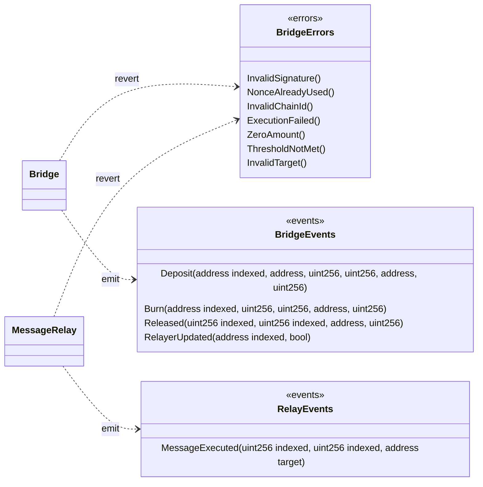
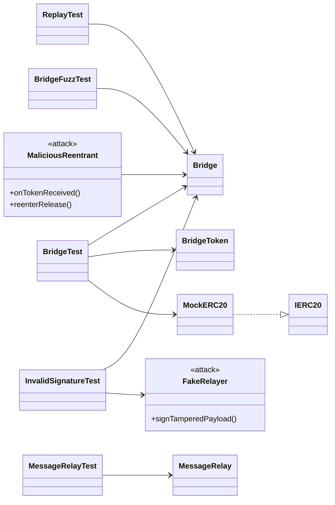
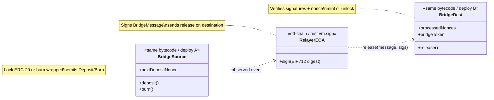

# Class diagram — Cross-Chain Bridge & Message Relay

🌐 [Español](./diagrama-clases-ES.md) · **English**

**To-be** structural model (module 09). Contracts, EIP-712/ECDSA interfaces, tokens and tests.

## 1. Main diagram (UML / Mermaid)

```mermaid
classDiagram
    direction TB

    class IERC20 {
        <<interface>>
        +balanceOf(address) uint256
        +transfer(address, uint256) bool
        +transferFrom(address, address, uint256) bool
        +approve(address, uint256) bool
    }

    class IBridge {
        <<interface>>
        +deposit(address token, uint256 amount, uint256 destChainId, address recipient)
        +burn(uint256 amount, uint256 destChainId, address recipient)
        +release(BridgeMessage message, bytes[] signatures)
        +processedNonces(uint256 sourceChainId, uint256 nonce) bool
    }

    class IMessageRelay {
        <<interface>>
        +execute(RelayMessage message, bytes[] signatures)
    }

    class IBridgeToken {
        <<interface>>
        +mint(address to, uint256 amount)
        +burn(address from, uint256 amount)
        +bridge() address
    }

    class BridgeMessage {
        <<struct>>
        uint256 sourceChainId
        uint256 destinationChainId
        uint256 nonce
        address target
        address recipient
        address token
        uint256 amount
    }

    class RelayMessage {
        <<struct>>
        uint256 sourceChainId
        uint256 destinationChainId
        uint256 nonce
        address target
        bytes payload
    }

    class Bridge {
        +mapping processedNonces
        +mapping isRelayer
        +uint256 relayerThreshold
        +uint256 nextDepositNonce
        +address immutable bridgeToken
        +deposit(token, amount, destChainId, recipient)
        +burn(amount, destChainId, recipient)
        +release(BridgeMessage, bytes[])
        -_verifySignatures(bytes32 digest, bytes[] sigs) bool
        -_hashMessage(BridgeMessage) bytes32
    }

    class MessageRelay {
        +mapping processedNonces
        +mapping isRelayer
        +uint256 relayerThreshold
        +execute(RelayMessage, bytes[])
        -_verifySignatures(bytes32 digest, bytes[] sigs) bool
    }

    class BridgeToken {
        +address immutable bridge
        +mint(address to, uint256 amount)
        +burn(address from, uint256 amount)
    }

    class BridgeHash {
        <<library>>
        +BRIDGE_MESSAGE_TYPEHASH bytes32
        +hash(BridgeMessage) bytes32
        +hash(RelayMessage) bytes32
    }

    class EIP712 {
        <<OZ>>
        #_hashTypedDataV4(bytes32) bytes32
        #_domainSeparatorV4() bytes32
    }

    class ECDSA {
        <<OZ library>>
        +recover(bytes32 hash, bytes signature) address
    }

    class SignatureChecker {
        <<OZ library>>
        +isValidSignatureNow(address, bytes32, bytes) bool
    }

    class ReentrancyGuard {
        <<OZ>>
        #nonReentrant()
    }

    class Ownable2Step {
        <<OZ>>
        +owner() address
        +transferOwnership(address)
    }

    class SafeERC20 {
        <<OZ library>>
        +safeTransfer(IERC20, address, uint256)
        +safeTransferFrom(IERC20, address, address, uint256)
    }

    class ERC20 {
        <<OZ>>
        +mint / burn via BridgeToken
    }

    IBridge <|.. Bridge
    IMessageRelay <|.. MessageRelay
    IBridgeToken <|.. BridgeToken
    EIP712 <|-- Bridge
    EIP712 <|-- MessageRelay
    ReentrancyGuard <|-- Bridge
    ReentrancyGuard <|-- MessageRelay
    Ownable2Step <|-- Bridge
    Ownable2Step <|-- MessageRelay
    ERC20 <|-- BridgeToken

    Bridge ..> BridgeMessage : release
    Bridge ..> BridgeHash : typed hash
    Bridge ..> ECDSA : recover
    Bridge ..> SignatureChecker : optional EOA/contract
    Bridge ..> IBridgeToken : mint / burn
    Bridge ..> IERC20 : lock / unlock
    Bridge ..> SafeERC20

    MessageRelay ..> RelayMessage
    MessageRelay ..> BridgeHash
    MessageRelay ..> ECDSA

    BridgeToken ..> Bridge : onlyBridge
```



## 2. Errors and events



## 3. Tests and actors



## 4. Responsibilities

| Artifact | Role |
|-----------|-----|
| `Bridge` | Lock/burn on source; verify EIP-712 + nonces; mint/unlock on destination |
| `MessageRelay` | Execute signed generic messages (same anti-replay scheme) |
| `BridgeToken` | Wrapped ERC-20; mint/burn only by `bridge` |
| `BridgeHash` | Stateless `TYPEHASH` + `structHash` |
| `EIP712` (OZ) | Domain separator (`name`, `version`, `chainId`, `verifyingContract`) |
| `ECDSA` / `SignatureChecker` | Recover signer / validate signature |
| `ReentrancyGuard` | Prevents reentering `deposit` / `burn` / `release` |
| `Ownable2Step` | Admin of the relayer set and threshold |
| `MaliciousReentrant` | Attempts to reenter `release` after mint |

## 5. Dependencies (summary)

```
Bridge
  ├── inherits   → EIP712, ReentrancyGuard, Ownable2Step
  ├── implements → IBridge
  ├── uses       → BridgeHash, ECDSA, SignatureChecker, SafeERC20
  ├── calls      → IBridgeToken.mint / burn; IERC20 transfer
  ├── state      → processedNonces, isRelayer, relayerThreshold, nextDepositNonce
  ├── emits      → Deposit / Burn / Released / RelayerUpdated
  └── reverts    → InvalidSignature / NonceAlreadyUsed / InvalidChainId /
                    ExecutionFailed / ZeroAmount / ThresholdNotMet / InvalidTarget

MessageRelay
  ├── inherits   → EIP712, ReentrancyGuard, Ownable2Step
  ├── implements → IMessageRelay
  ├── uses       → BridgeHash, ECDSA
  ├── emits      → MessageExecuted
  └── reverts    → same verification errors + ExecutionFailed

BridgeToken
  ├── inherits   → ERC20 (OZ)
  ├── implements → IBridgeToken
  ├── immutable  → bridge
  └── only bridge can mint/burn
```

## 6. Solidity layout

### Bridge

1. Imports / interfaces / libraries / struct `BridgeMessage`  
2. Contract `Bridge` (EIP712, ReentrancyGuard, Ownable2Step)  
3. Immutables + state (`processedNonces`, relayers, threshold, nonce)  
4. Events → Errors → Modifiers  
5. External: `deposit`, `burn`, `release`, relayer admin  
6. Internal: `_hashMessage`, `_verifySignatures`, `_mintOrUnlock`

### MessageRelay

1. Imports + struct `RelayMessage`  
2. Nonce / relayer state (same pattern)  
3. External: `execute`  
4. Internal: verify + `target.call(payload)`

### BridgeToken

1. ERC20 + `immutable bridge`  
2. `mint` / `burn` with `onlyBridge`

## 7. Source ↔ destination relationship (logical)



In Foundry tests, **two contexts** are simulated with `vm.chainId` / two deployments, or a single contract acting as both source (deposit) and destination (release) with explicit chain IDs in the struct.
