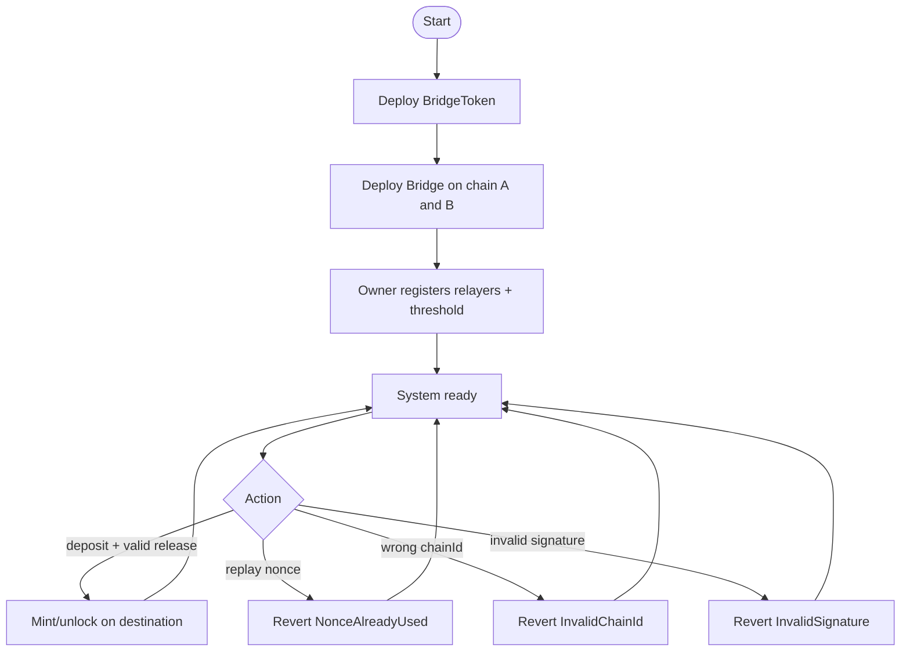
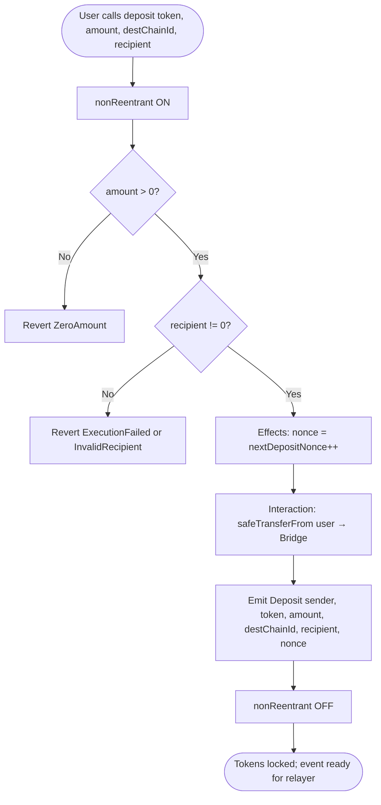
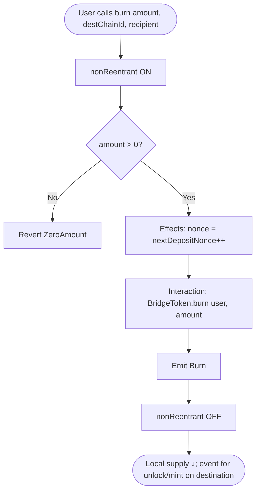
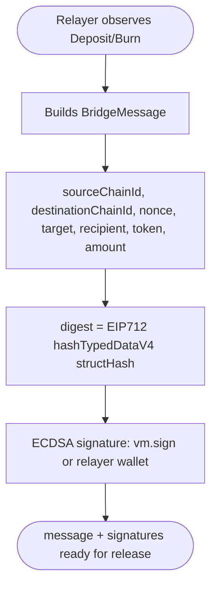
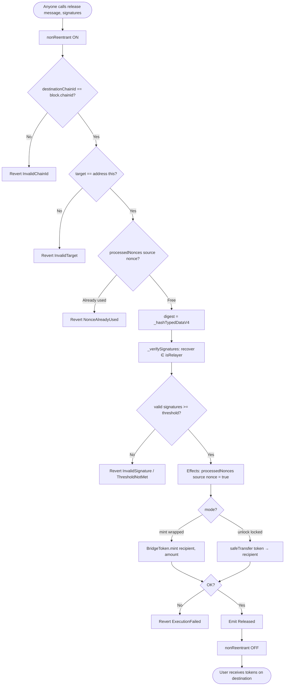
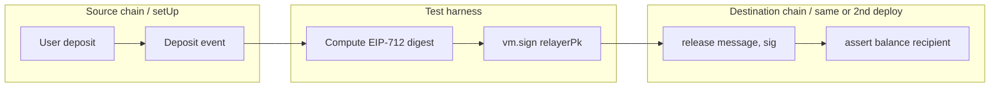
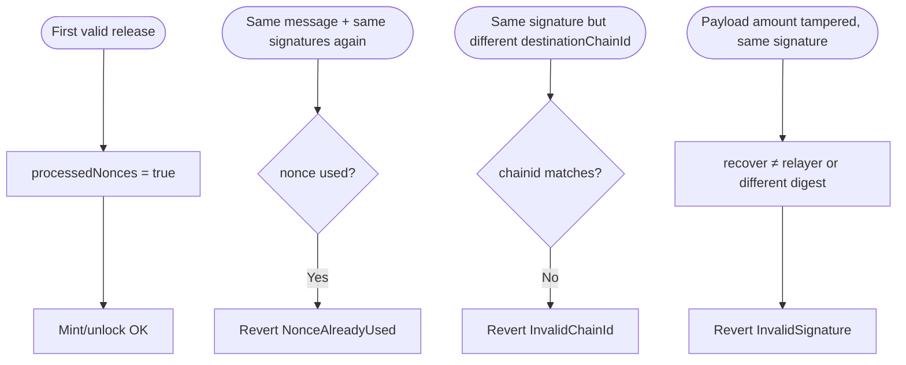
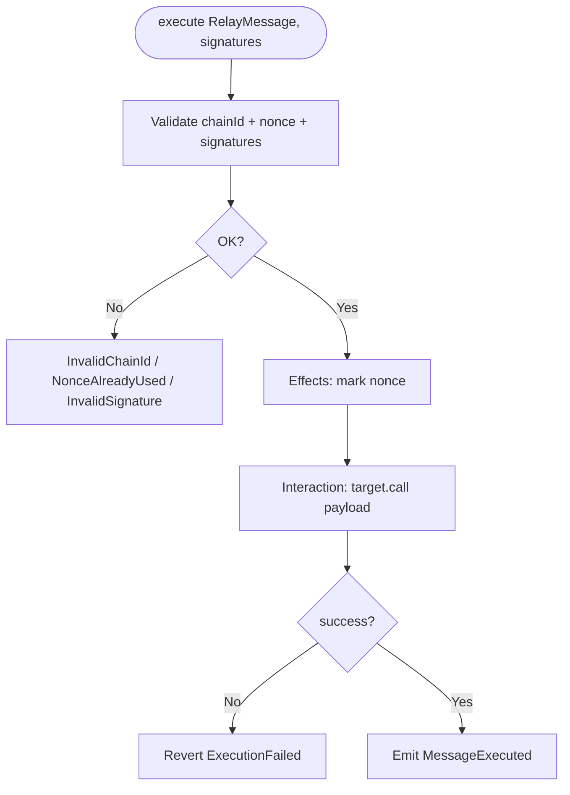
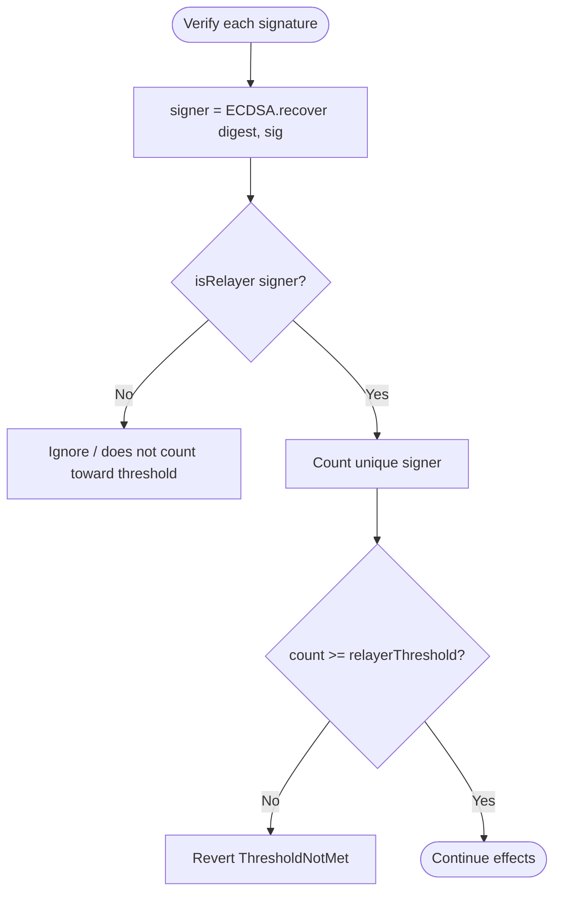

# Flow diagram — Cross-Chain Bridge & Message Relay

🌐 [Español](./diagrama-flujo-ES.md) · **English**

**To-be** business flows (v1). See also [flujograma-EN.md](./flujograma-EN.md) and [PLANIFICACION-EN.md](./PLANIFICACION-EN.md).

## 1. System lifecycle

## 2. Source flow: `deposit` (lock)

## 3. Source flow: `burn` (wrapped → another chain)

## 4. Off-chain flow: EIP-712 signature (relayer / test)

In Foundry: `digest` is computed exactly as on-chain; `(v, r, s) = vm.sign(relayerPk, digest)`.

## 5. Destination flow: `release` (mint / unlock)

## 6. E2E flow (Foundry test)

## 7. Anti-replay flow

## 8. MessageRelay.execute flow

## 9. Relayer authentication flow

Duplicate signatures from the same relayer must not count twice toward the threshold.

## Legend

| Symbol | Meaning |
|---------|-------------|
| Rectangle | On-chain process / action |
| Diamond | Decision / validation |
| Oval | Start / end |

## CEI order

| Step | `deposit` / `burn` | `release` |
|------|--------------------|-----------|
| **Checks** | amount, recipient | chainId, target, free nonce, signatures |
| **Effects** | increment deposit nonce | `processedNonces[...] = true` |
| **Interactions** | transferFrom / burn | mint / transfer / call |
| **Final checks** | — | mint/transfer success or `ExecutionFailed` |
