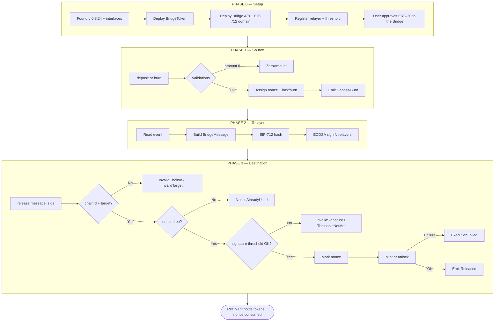
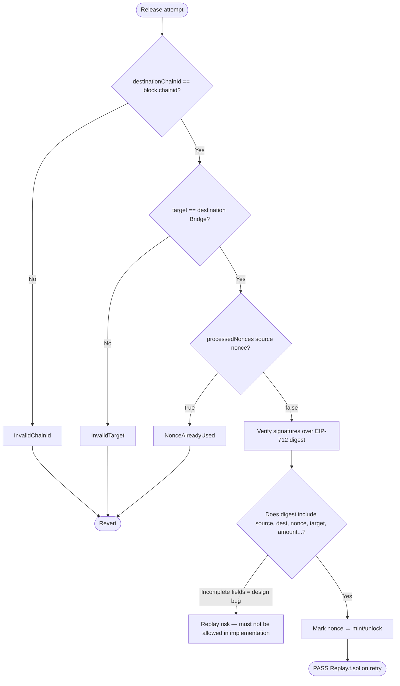
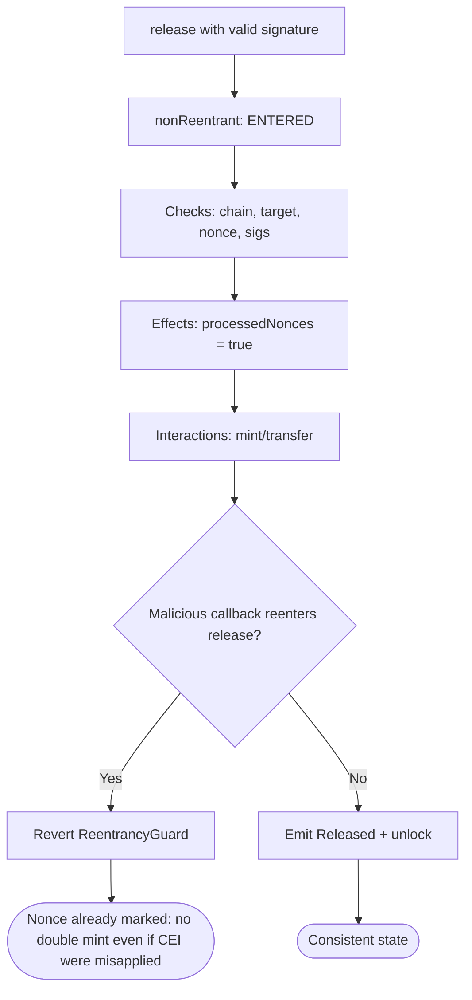
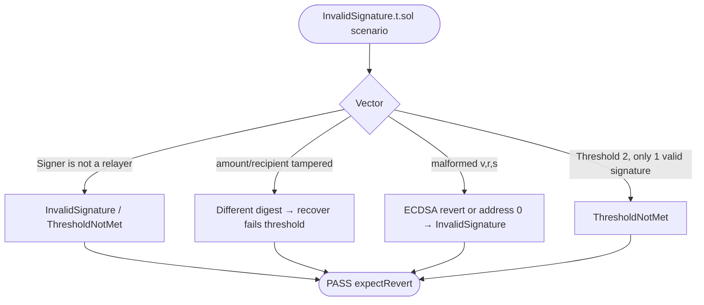
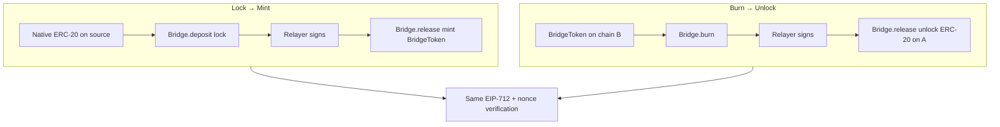

# Project flowchart — Cross-Chain Bridge & Message Relay

🌐 [Español](./flujograma-ES.md) · **English**

**To-be** operational flowchart (v1): setup → deposit/burn → signature → release → anti-replay → security → TDD.

## 1. System master flowchart

## 2. Detailed anti-replay flowchart

The digest **must** include the module's four guard fields: `sourceChainId`, `destinationChainId`, `nonce`, `target`.

## 3. Security flowchart (reentrancy + CEI)

Marking the nonce **before** the mint prevents double minting even if reentrancy protection were to fail in a hypothetical scenario.

## 4. Invalid signatures flowchart

## 5. Development pipeline flowchart (TDD)

```mermaid
flowchart LR
    A[.cursorrules] --> B[Planning docs + diagrams]
    B --> C[Foundry scaffold + interfaces]
    C --> D[Red e2e tests]
    D --> E[BridgeToken + deposit]
    E --> F[release + vm.sign]
    F --> G[Replay.t.sol]
    G --> H[InvalidSignature.t.sol]
    H --> I[MessageRelay + N-of-M threshold]
    I --> J[Fuzz amount/chainId/nonce]
    J --> K[Gas + NatSpec + Deploy]
    K --> L([Module closed])
```

## 6. Flow ↔ function ↔ invariant matrix

| Flowchart step | Function | Invariant / postcondition |
|---------------------|---------|----------------------------|
| Source lock | `Bridge.deposit` | Bridge balance ↑; event with unique nonce |
| Source burn | `Bridge.burn` | wrapped supply ↓; event |
| Signature | off-chain / `vm.sign` | digest = same on-chain `_hashTypedDataV4` |
| Release OK | `Bridge.release` | `processedNonces` true; recipient ↑ amount |
| Replay | `Bridge.release` | second call → `NonceAlreadyUsed` |
| Wrong chain | `Bridge.release` | `InvalidChainId` |
| Bad signature | `Bridge.release` | `InvalidSignature` / `ThresholdNotMet` |
| Generic message | `MessageRelay.execute` | call OK or `ExecutionFailed`; nonce marked |
| Reentrancy | `release` / `deposit` | second entry reverts |

## 7. Lock-mint vs burn-unlock flowchart

## 8. How to read these diagrams

1. **Setup**: wrapped token, Bridge(s), relayers and threshold.
2. **Source**: the user provides liquidity (lock) or burns wrapped tokens; the nonce is recorded in the event.
3. **Relayer**: signs the full EIP-712 struct (not just the hash of the raw event without a domain).
4. **Destination**: validate chain, target, nonce and threshold → mark nonce → mint/unlock.
5. **TDD**: docs → red e2e tests → implementation → replay/signatures → fuzz → closure.
